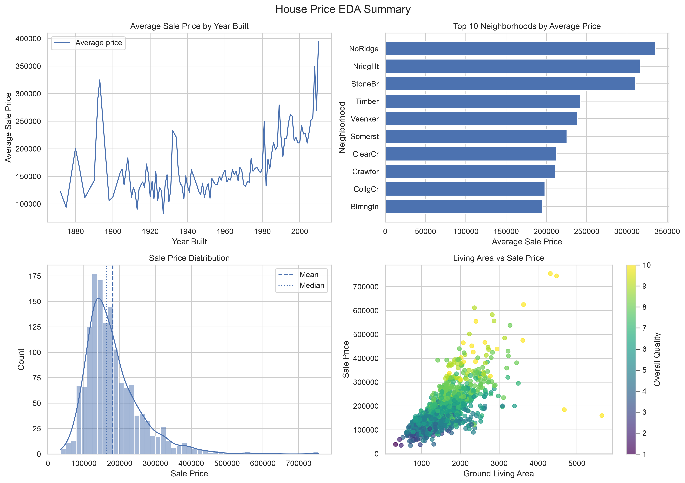

# House Price Exploratory Data Analysis (EDA)

## Project Overview
This project performs Exploratory Data Analysis (EDA) on the House Prices - Advanced Regression Techniques Ames Housing Dataset to understand
the factors affecting house sale. 


## Objectives
- Understand the dataset structure.
- Analyze house price distributions.
- Study correlations between numerical features.
- Identify outliers.
- Handle missing values.
- Visualize important patterns.

## Technologies Used 
- Python
- Pandas
- Numpy
- Matplotlib
- Seaborn
- Scipy

## Dataset 
House Prices - Advanced Regression Techniques Ames Housing Dataset (train.csv)

- 1460 rows
- 81 columns

## Dataset Source
Source: [Kaggle - House Prices: Advanced Regression Techniques](https://www.kaggle.com/competitions/house-prices-advanced-regression-techniques) 

Dataset: Ames Housing Dataset.

## Project Structure

```text
House-Price-EDA/
│
├── House_Price_EDA.ipynb
│
├── train.csv
│
├── eda_dashboard.png
│
├── README.md
│
└── requirements.txt
```

## Project Dashboard Visualizations 

 


## Learning Outcomes

Through this project, I gained practical experience in:

- Python programming for data analysis.
- Data cleaning and preprocessing.
- Statistical analysis.
- Data visualization.
- Correlation and outlier analysis.
- Working with real-world datasets.
- Presenting analytical findings through a dashboard.

## Key Findings
- Houses prices are right-skewed.
- Overall quality and living area are important factors
  related to sale price.
- Neighbourhood show differences in average house prices.
- Outliers and missing values were examined.

## Conclusion
This project demonstrates Exploratory Data Analysis using Python. No machine learning model was developed.
